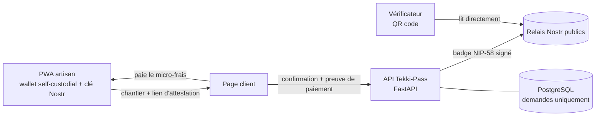

# Tekki-Pass

> Chaque chantier payé en Lightning devient une preuve de travail vérifiable par n'importe qui, même sans nous.

🇬🇧 [English version](README.md)

**Tekki-Pass** (« tekki » = réussir, en wolof) donne aux artisans du BTP sénégalais (carreleurs, maçons, électriciens, plombiers) un historique de travail public et vérifiable. Le client confirme un chantier terminé et paie un micro-frais en Lightning. Tekki-Pass signe alors une attestation et la publie sur Nostr, et n'importe qui peut la vérifier en scannant un QR code.

Projet du [Dakar Bitcoin Hack 2026](https://dakar-bitcoin-hack-2026.devpost.com/) (BTrust). État : **fondations du dépôt, fonctionnalités pas encore développées.**

---

## Parcours pour le jury

> TODO : lien vers la démo en ligne et la vidéo de 3 minutes une fois déployées.

Persona de démo (fictif) : **Moussa**, carreleur à Dakar.

1. Moussa crée son profil. Son wallet Lightning self-custodial et sa clé Nostr sont générés, et il sauvegarde sa phrase de récupération.
2. Il décrit son chantier, par écrit (note vocale avec IA en option).
3. Il envoie un lien à son client par WhatsApp.
4. Le client ouvre le lien, confirme le chantier et paie le micro-frais en Lightning.
5. L'attestation est signée et publiée sur Nostr. Les sats arrivent dans le wallet de Moussa.
6. Un vérificateur scanne le QR code de Moussa et voit chaque chantier attesté avec sa preuve de paiement.

| Étape | URL / action | État |
| ----- | ------------ | ---- |
| 1–6   | TODO         | TODO |

## Démarrage rapide

Prérequis : Docker avec Compose v2.

```bash
cp .env.example .env        # facultatif : les valeurs par défaut suffisent en local
docker compose up --build
```

- Appli web : http://localhost:3000
- Santé de l'API : http://localhost:8000/health

Développement sans Docker : voir [CONTRIBUTING.md](CONTRIBUTING.md#local-development).

## Architecture

Les sats vont directement dans le wallet de l'artisan, et les attestations sur des relais Nostr publics. L'API ne garde ni l'un ni l'autre.



| Dossier    | Contenu                                                                     |
| ---------- | --------------------------------------------------------------------------- |
| `apps/web` | PWA Next.js + TypeScript (mobile d'abord, français d'abord, wolof prévu)    |
| `apps/api` | FastAPI, Python 3.12, entièrement typé. Orchestration seulement : ne détient jamais de fonds |
| `docs/adr` | Décisions d'architecture (ADR)                                              |
| `.github`  | CI, modèles d'issue et de PR                                                |

Décisions clés : voir les [ADR](docs/adr/) (wallet self-custodial, attestations Nostr NIP-58, micro-frais Lightning, environnements testnet et mainnet).

## Contraintes

- **Utilisateurs :** des artisans parfois peu à l'aise avec l'écrit, sur des Android d'entrée de gamme en 3G. L'interface utilise des mots simples (« paiement », « preuve »), un texte de 16 px minimum et un contraste WCAG AA.
- **Souveraineté :** Tekki-Pass ne détient ni l'argent ni les preuves de l'artisan.
- **Vie privée :** ni nom ni numéro sur Nostr, seulement un hash protégé par une clé secrète (HMAC) du numéro du client. Aucune donnée personnelle dans les logs.
- **Sécurité :** pas de cryptographie maison, dépendances épinglées, secrets uniquement en variables d'environnement. Voir [SECURITY.md](SECURITY.md).
- **Réseau :** testnet par défaut. Mainnet seulement pour une démo explicite, en attendant la réponse des organisateurs (ADR 0004).
- **Délai :** soumission le 20 novembre 2026, 20h00 UTC.

Le modèle de menaces complet figure dans le [README anglais](README.md#threat-model-mvp) et dans la [fiche projet](docs/project-brief.md).

## Contribuer et licence

Voir [CONTRIBUTING.md](CONTRIBUTING.md) et le [Code de conduite](CODE_OF_CONDUCT.md). Publié sous [licence MIT](LICENSE).
