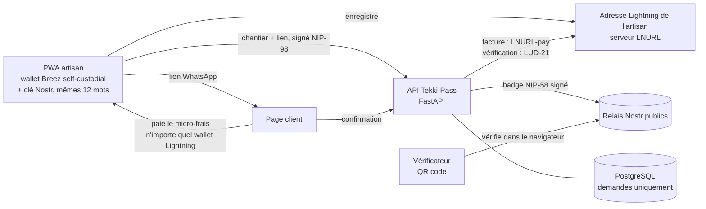

# Tekki-Pass

> Chaque chantier confirmé par le client devient une preuve de travail vérifiable par n'importe qui, même sans nous. Le chantier est payé comme d'habitude (en CFA) ; seule la preuve coûte quelques sats en Lightning.

🇬🇧 [English version](README.md)

**Tekki-Pass** (« tekki » = réussir, en wolof) donne aux artisans du BTP sénégalais (carreleurs, maçons, électriciens, plombiers) un historique de travail public et vérifiable. Le client confirme un chantier terminé et paie un micro-frais en Lightning. Tekki-Pass signe alors une attestation et la publie sur Nostr, et n'importe qui peut la vérifier en scannant un QR code.

Projet du [Dakar Bitcoin Hack 2026](https://dakar-bitcoin-hack-2026.devpost.com/) (BTrust).

**État (20 nov. 2026) :** tout le parcours fonctionne de bout en bout. La démo en ligne et la démo locale tournent avec des **paiements simulés (testnet)** : n'importe qui peut les essayer sans wallet ni sats. Les vrais paiements Lightning sont prêts et s'activent par un réglage : un wallet self-custodial Breez SDK - Spark dans l'appli de l'artisan, testé sur mainnet jusqu'à une vraie facture de 210 sats obtenue auprès de l'adresse Lightning de l'artisan.

---

## Parcours pour le jury

> **Vidéo de 3 minutes :** [youtu.be/QMzI7BDOyt8](https://youtu.be/QMzI7BDOyt8) · **Démo en ligne :** un serveur de test permanent est en cours de mise en place ; en attendant, elle se lance en local en une commande (voir Démarrage rapide).

Persona de démo (fictif) : **Moussa**, carreleur à Dakar.

| # | Étape | Où (démo locale) | État |
| --- | --- | --- | --- |
| 1 | Moussa crée son profil : 12 mots de récupération, vérification de 3 mots, code à 6 chiffres. Sa clé Nostr est dérivée de ces mots (NIP-06). | `/artisan` | ✅ |
| 1b | Il ouvre **Mon portefeuille** : les mêmes 12 mots créent son wallet Lightning (Breez SDK - Spark, sur son téléphone), qui enregistre son adresse Lightning. Une seule sauvegarde pour tout. | `/artisan` | ✅ |
| 2 | Il décrit un chantier terminé et envoie le lien à son client par WhatsApp. La demande est signée avec sa clé (NIP-98). | `/artisan` | ✅ |
| 3 | Le client ouvre le lien, confirme le chantier avec son numéro et voit le QR code de paiement. | `/a/<token>` | ✅ |
| 4 | Le client paie le micro-frais depuis n'importe quel wallet Lightning. Les sats arrivent directement dans le wallet de Moussa, même si son téléphone est éteint. | Wallet Lightning | 🟡 simulé sur les démos (« Simuler le paiement », testnet) ; paiement réel prêt, testé jusqu'à la facture mainnet |
| 5 | Tekki-Pass vérifie la preuve de paiement, signe l'attestation (badge NIP-58) et la publie sur les relais Nostr. | API | ✅ |
| 6 | Un vérificateur scanne le QR code de Moussa et voit chaque chantier « ✓ Vérifié », contrôlé dans son propre navigateur. | `/p/<pubkey>` | ✅ |

## Démarrage rapide

Prérequis : Docker avec Compose v2.

```bash
cp .env.example .env        # facultatif : les valeurs par défaut suffisent en local
docker compose up --build
```

- Appli web : http://localhost:3000 (commencer par « Je suis artisan »)
- Documentation de l'API : http://localhost:8000/docs
- Relais Nostr local : ws://localhost:7777

Ports déjà utilisés ? Définis `WEB_PORT`, `API_PORT` et `RELAY_PORT` dans `.env`.

La démo locale est sans risque : paiements simulés, relais local uniquement (rien n'est publié sur les relais publics), clés jetables générées au démarrage.

Développement sans Docker : voir [CONTRIBUTING.md](CONTRIBUTING.md#local-development).

## Architecture

Les sats vont directement dans le wallet de l'artisan, et les attestations sur des relais Nostr publics. L'API ne garde ni l'un ni l'autre.



| Dossier    | Contenu                                                                     |
| ---------- | --------------------------------------------------------------------------- |
| `apps/web` | PWA Next.js + TypeScript (mobile d'abord, français d'abord, wolof prévu)    |
| `apps/api` | FastAPI, Python 3.12, entièrement typé. Orchestration seulement : ne détient jamais de fonds |
| `docs/adr` | Décisions d'architecture (ADR)                                              |
| `deploy`   | Mise en ligne sur un serveur (Docker Compose + Caddy, HTTPS automatique)    |
| `.github`  | CI, modèles d'issue et de PR                                                |

Comment fonctionne la confiance :

- **Preuve de paiement :** une facture Lightning payée révèle une preimage dont le SHA-256 est le hash du paiement. L'attestation contient les deux. L'API obtient la facture auprès de l'adresse Lightning de l'artisan (LNURL-pay) et la preimage par sa vérification publique LUD-21 : elle ne détient ni clé ni sat, et le téléphone de l'artisan peut être hors ligne.
- **Preuve de l'émetteur :** l'attestation est un événement Nostr signé par la clé de Tekki-Pass, publié avec la définition de son badge (kind 30009).
- **Vérifiable par tous :** la page publique lit les attestations directement sur les relais Nostr (notre API ne sert qu'en secours) et revérifie la signature, la clé de l'émetteur et la preuve de paiement dans le navigateur du visiteur, sans faire confiance à notre serveur.

Décisions clés : voir les [ADR](docs/adr/) (wallet self-custodial, attestations Nostr NIP-58, micro-frais Lightning, environnements testnet et mainnet, SDK Lightning Breez Spark).

Construit avec :

- **Lightning :** [Breez SDK - Spark](https://sdk-doc-spark.breez.technology/) dans la PWA (WASM, chargé seulement sur l'écran du portefeuille) ; LNURL-pay et LUD-21 côté API.
- **Nostr :** [nostr-tools](https://github.com/nbd-wtf/nostr-tools) dans le navigateur, [rust-nostr](https://github.com/rust-nostr/nostr) (`nostr-sdk`) dans l'API ; NIP-06, NIP-58, NIP-98.
- **Appli :** PWA Next.js avec service worker (3G et hors ligne, voir [apps/web/README.md](apps/web/README.md)), FastAPI, PostgreSQL.

Mise en ligne sur un serveur : [deploy/README.md](deploy/README.md).

## Contraintes

- **Utilisateurs :** des artisans parfois peu à l'aise avec l'écrit, sur des Android d'entrée de gamme en 3G. L'interface utilise des mots simples (« paiement », « preuve »), un texte de 16 px minimum et un contraste WCAG AA.
- **Souveraineté :** Tekki-Pass ne détient ni l'argent ni les preuves de l'artisan.
- **Vie privée :** ni nom ni numéro sur Nostr, seulement un hash protégé par une clé secrète (HMAC) du numéro du client. Aucune donnée personnelle dans les logs.
- **Sécurité :** pas de cryptographie maison, dépendances épinglées, secrets uniquement en variables d'environnement. Voir [SECURITY.md](SECURITY.md).
- **Réseau :** testnet avec paiements simulés pour les démos. Le Lightning de Breez n'existe que sur mainnet : les vrais paiements utilisent mainnet avec quelques sats (ADR 0005), activés par `NETWORK=mainnet` et `LIGHTNING_BACKEND=lnurl` (deploy/README.md, étape 6). Les organisateurs n'ont pas encore dit si mainnet est obligatoire (ADR 0004).
- **Délai :** soumission le 20 novembre 2026, 20h00 UTC.

Le modèle de menaces complet, avec l'état de chaque protection, figure dans le [README anglais](README.md#threat-model-mvp).

## Indicateurs

Ce que nous mesurerons. Les valeurs cibles seront fixées après les entretiens terrain : aucun chiffre n'est inventé ici.

| Indicateur | Ce qu'il mesure | Source |
| --- | --- | --- |
| Artisans actifs par semaine | Adoption côté offre | Base de données |
| Attestations publiées par semaine | Usage réel | Relais Nostr + base |
| Part des demandes d'attestation payées | Friction côté client | Wallet + base |
| Temps du lien envoyé à l'attestation publiée | Fluidité du parcours | Logs anonymisés |
| Vérifications par QR code | Intérêt des vérificateurs | Page publique |
| Part des comptes avec une sauvegarde vérifiée | Sécurité des fonds | Appli |
| Attestations signalées comme suspectes | Fraude détectée | Signaux anti-collusion |

## Prochaine itération

- **Avant le pitch final :** note vocale → fiche chantier (IA, wolof ou français), interface en wolof, signaux anti-collusion (un client qui atteste tout le monde), connexion d'un wallet existant via NWC.
- **Plus tard :** horodatage OpenTimestamps, émetteurs accrédités (Chambre des Métiers, maîtres d'œuvre agréés), divulgation sélective, score microfinance, API B2B de vérification, paiement de l'acompte ou du chantier en Lightning.

## Questions ouvertes

- **Micro-frais :** 210 sats par attestation pour le MVP, à ajuster après les entretiens terrain (ADR 0003).
- **Mainnet ou testnet :** question posée aux organisateurs, sans réponse pour l'instant. En attendant : testnet avec paiements simulés pour les démos, mainnet prêt pour les vrais paiements (ADR 0004, ADR 0005).
- **Réglementation :** cadre BCEAO / UEMOA sur les crypto-actifs, à étudier avant tout lancement au-delà du pilote.

## Contribuer et licence

Voir [CONTRIBUTING.md](CONTRIBUTING.md) et le [Code de conduite](CODE_OF_CONDUCT.md). Publié sous [licence MIT](LICENSE).
