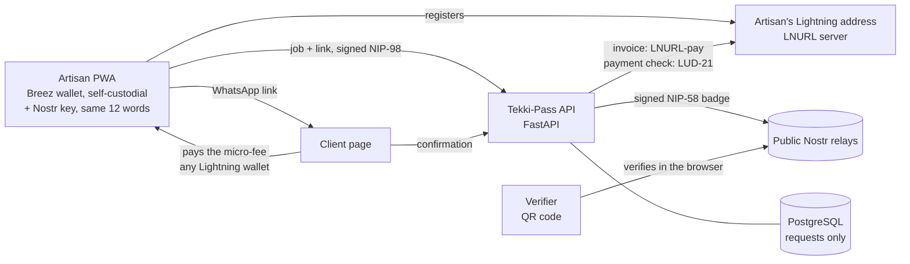

# Tekki-Pass

> Every client-confirmed job becomes a proof of work anyone can verify, even without us. The job is paid as usual (in CFA); only the proof costs a few sats over Lightning.

🇫🇷 [Version française](README.fr.md)

**Tekki-Pass** ("tekki" means _to succeed_ in Wolof) gives Senegalese construction artisans (tilers, masons, electricians, plumbers) a public, verifiable work history. The client confirms a finished job and pays a small Lightning fee. Tekki-Pass then signs an attestation and publishes it on Nostr, and anyone can check it by scanning a QR code.

Built for the [Dakar Bitcoin Hack 2026](https://dakar-bitcoin-hack-2026.devpost.com/) (BTrust).

**Status (20 Nov 2026):** the whole flow works end to end. The live demo and the local demo run with **simulated payments (testnet)**, so anyone can try them with no wallet and no sats. Real Lightning payments are built and switch on with one setting: a self-custodial Breez SDK - Spark wallet in the artisan's app, tested on mainnet up to a real 210-sat invoice from the artisan's Lightning address.

---

## Jury walkthrough

> **Live demo:** _link added at submission_ · **3-minute video:** _link added at submission_

Demo persona (fictional): **Moussa**, a tiler in Dakar.

| # | Step | Where (local demo) | Status |
| --- | --- | --- | --- |
| 1 | Moussa creates his profile: 12-word recovery phrase, check of 3 words, 6-digit PIN. His Nostr key is derived from the phrase (NIP-06). | `/artisan` | ✅ |
| 1b | He opens **Mon portefeuille**: the same 12 words seed his Lightning wallet (Breez SDK - Spark, on his phone), which registers his Lightning address. One backup for everything. | `/artisan` | ✅ |
| 2 | He describes a finished job and sends the link to his client over WhatsApp. The request is signed with his key (NIP-98). | `/artisan` | ✅ |
| 3 | The client opens the link, confirms the job with their phone number and sees the payment QR code. | `/a/<token>` | ✅ |
| 4 | The client pays the micro-fee from any Lightning wallet. The sats go straight to Moussa's wallet, even if his phone is off. | Lightning wallet | 🟡 simulated on the demos ("Simuler le paiement", testnet); real payments ready, tested up to the mainnet invoice |
| 5 | Tekki-Pass checks the proof of payment, signs the attestation (NIP-58 badge) and publishes it on Nostr relays. | API | ✅ |
| 6 | A verifier scans Moussa's QR code and sees each job "✓ Vérifié", checked in their own browser. | `/p/<pubkey>` | ✅ |

## Quick start

Prerequisites: Docker with Compose v2.

```bash
cp .env.example .env        # optional: defaults work for local development
docker compose up --build
```

- Web app: http://localhost:3000 (start with "Je suis artisan")
- API docs: http://localhost:8000/docs
- Local Nostr relay: ws://localhost:7777

Ports already in use? Set `WEB_PORT`, `API_PORT` and `RELAY_PORT` in `.env`.

The local stack is a safe demo: simulated payments, a local relay only (nothing reaches public relays) and throwaway keys generated at startup.

Development without Docker: see [CONTRIBUTING.md](CONTRIBUTING.md#local-development).

## Architecture

The sats go straight to the artisan's wallet, and attestations go to public Nostr relays. The API keeps neither.



| Path         | What it is                                                              |
| ------------ | ----------------------------------------------------------------------- |
| `apps/web`   | Next.js + TypeScript PWA (mobile-first, French first, Wolof planned)    |
| `apps/api`   | FastAPI, Python 3.12, fully typed. Orchestration only: never holds funds |
| `docs/adr`   | Architecture Decision Records                                           |
| `deploy`     | Single-server production stack (Docker Compose + Caddy, automatic HTTPS) |
| `.github`    | CI, issue and PR templates                                              |

How trust works:

- **Proof of payment:** a paid Lightning invoice reveals a preimage whose SHA-256 is the payment hash. The attestation carries both. The API gets the invoice from the artisan's Lightning address (LNURL-pay) and the preimage from its public LUD-21 check: it never holds a key or a sat, and the artisan's phone can be offline.
- **Proof of issuer:** the attestation is a Nostr event signed by the Tekki-Pass issuer key, published with its badge definition (kind 30009).
- **Anyone can check:** the public page reads the attestations directly from the Nostr relays (our API is only a fallback) and re-verifies the signature, the issuer key and the proof of payment in the visitor's browser, without trusting our server.

Key decisions:

- [ADR 0001: self-custodial wallet](docs/adr/0001-self-custodial-wallet.md)
- [ADR 0002: Nostr NIP-58 attestations](docs/adr/0002-nostr-nip58-attestations.md)
- [ADR 0003: Lightning micro-fee model](docs/adr/0003-lightning-micro-fee.md)
- [ADR 0004: testnet and mainnet environments](docs/adr/0004-testnet-and-mainnet.md)
- [ADR 0005: Lightning SDK, Breez SDK - Spark](docs/adr/0005-lightning-sdk-breez-spark.md)

Built with:

- **Lightning:** [Breez SDK - Spark](https://sdk-doc-spark.breez.technology/) in the PWA (WASM, loaded only on the wallet screen); LNURL-pay and LUD-21 on the API side.
- **Nostr:** [nostr-tools](https://github.com/nbd-wtf/nostr-tools) in the browser, [rust-nostr](https://github.com/rust-nostr/nostr) (`nostr-sdk`) in the API; NIP-06, NIP-58, NIP-98.
- **App:** Next.js PWA with a service worker (3G and offline, see [apps/web/README.md](apps/web/README.md)), FastAPI, PostgreSQL.

Deployment on one server: [deploy/README.md](deploy/README.md).

## Constraints

- **Users:** artisans who may not be comfortable with writing, on entry-level Android phones over 3G. The UI uses plain words ("payment", "proof"), 16 px minimum text and WCAG AA contrast.
- **Sovereignty:** Tekki-Pass never holds the artisan's money or proofs.
- **Privacy:** no names or phone numbers on Nostr, only a keyed hash (HMAC) of the client's number. No personal data in logs.
- **Security:** no home-made cryptography, pinned dependencies, secrets only in environment variables. See [SECURITY.md](SECURITY.md).
- **Network:** testnet with simulated payments for the demos. Breez Lightning only exists on mainnet: real payments use mainnet with a few sats (ADR 0005), switched on with `NETWORK=mainnet` and `LIGHTNING_BACKEND=lnurl` (deploy/README.md, step 6). The organizers have not answered yet whether mainnet is required (ADR 0004).
- **Time:** submission is due on 20 November 2026, 20:00 UTC.

### Threat model (MVP)

| Threat | MVP mitigation | Status |
| --- | --- | --- |
| Fake attestations (collusion) | Mandatory micro-fee, cap of 5 attestations per client over 30 days | ✅ |
| Requests created in an artisan's name | Requests signed with the artisan's Nostr key (NIP-98), anti-replay | ✅ |
| Lost or stolen phone | Recovery phrase backed up and checked at sign-up, local PIN (encrypted storage) | ✅ |
| Issuer impersonation | Issuer public key checked on the verification page | ✅ |
| Attestation replay | Unique ID bound to the payment hash and the artisan's key | ✅ |
| Personal data leak | Only a keyed hash (HMAC) of the client's number is published | ✅ |
| Server secret theft | Environment variables only, never committed; secret scan in CI | ✅ |
| Malicious input | Strict validation of every input | ✅ |
| Request flooding | Rate limiting per client IP (429 + Retry-After) | ✅ |
| Server-side request forgery via a Lightning address | HTTPS only, public hosts only, no redirects, short timeouts, optional domain allowlist | ✅ |
| Personal data in logs | JSON request logs with the route template only: no token, phone number or IP | ✅ |

## Metrics

What we will measure. Targets are set after the field interviews: no figure is invented here.

| Metric | What it tells us | Source |
| --- | --- | --- |
| Weekly active artisans | Supply-side adoption | Database |
| Attestations published per week | Real usage | Nostr relays + database |
| Share of attestation requests paid | Client-side friction | Wallet + database |
| Time from link sent to attestation published | Flow smoothness | Anonymized logs |
| QR code verifications | Verifier interest | Public page |
| Share of accounts with a checked recovery backup | Safety of funds | App |
| Attestations flagged as suspicious | Fraud detected | Anti-collusion signals |

## Next iteration

- **Before the final pitch:** voice note → job sheet (AI, Wolof or French), Wolof interface, anti-collusion signals (a client who attests everyone), connecting an existing wallet via NWC.
- **Later:** OpenTimestamps anchoring, accredited issuers (Chambre des Métiers, approved site managers), selective disclosure, microfinance score, B2B verification API, paying the deposit or the whole job over Lightning.

## Open questions

- **Micro-fee:** 210 sats per attestation for the MVP, to be adjusted after the field interviews (ADR 0003).
- **Mainnet or testnet:** asked to the organizers, no answer yet. Until then: testnet with simulated payments for the demos, mainnet ready for real payments (ADR 0004, ADR 0005).
- **Regulation:** BCEAO / UEMOA framework for crypto-assets, to be reviewed before any launch beyond the pilot.

## Contributing and license

See [CONTRIBUTING.md](CONTRIBUTING.md) and the [Code of Conduct](CODE_OF_CONDUCT.md). Released under the [MIT License](LICENSE).
