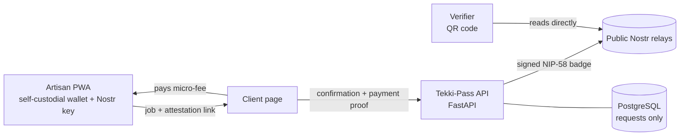

# Tekki-Pass

> Every job paid over Lightning becomes a proof of work anyone can verify, even without us.

🇫🇷 [Version française](README.fr.md)

**Tekki-Pass** ("tekki" means _to succeed_ in Wolof) gives Senegalese construction artisans (tilers, masons, electricians, plumbers) a public, verifiable work history. The client confirms a finished job and pays a small Lightning fee. Tekki-Pass then signs an attestation and publishes it on Nostr, and anyone can check it by scanning a QR code.

Built for the [Dakar Bitcoin Hack 2026](https://dakar-bitcoin-hack-2026.devpost.com/) (BTrust). Status: **repository foundation, features not implemented yet.**

---

## Jury walkthrough

> TODO: link to the live demo and the 3-minute video once they are deployed.

Demo persona (fictional): **Moussa**, a tiler in Dakar.

1. Moussa creates his profile. His self-custodial Lightning wallet and Nostr key are generated, and he backs up his recovery phrase.
2. He describes a job, in writing (voice note with AI is optional).
3. He sends a link to his client over WhatsApp.
4. The client opens the link, confirms the job and pays the micro-fee over Lightning.
5. The attestation is signed and published on Nostr. The sats land in Moussa's wallet.
6. A verifier scans Moussa's QR code and sees each attested job with its proof of payment.

| Step | URL / action | Status |
| ---- | ------------ | ------ |
| 1–6  | TODO         | TODO   |

## Quick start

Prerequisites: Docker with Compose v2.

```bash
cp .env.example .env        # optional: defaults work for local development
docker compose up --build
```

- Web app: http://localhost:3000
- API health: http://localhost:8000/health

Development without Docker: see [CONTRIBUTING.md](CONTRIBUTING.md#local-development).

## Architecture

The sats go straight to the artisan's wallet, and attestations go to public Nostr relays. The API keeps neither.



| Path         | What it is                                                              |
| ------------ | ----------------------------------------------------------------------- |
| `apps/web`   | Next.js + TypeScript PWA (mobile-first, French first, Wolof planned)    |
| `apps/api`   | FastAPI, Python 3.12, fully typed. Orchestration only: never holds funds |
| `docs/adr`   | Architecture Decision Records                                           |
| `.github`    | CI, issue and PR templates                                              |

Key decisions:

- [ADR 0001: self-custodial wallet](docs/adr/0001-self-custodial-wallet.md)
- [ADR 0002: Nostr NIP-58 attestations](docs/adr/0002-nostr-nip58-attestations.md)
- [ADR 0003: Lightning micro-fee model](docs/adr/0003-lightning-micro-fee.md)
- [ADR 0004: testnet and mainnet environments](docs/adr/0004-testnet-and-mainnet.md)
- [ADR 0005: Lightning SDK, Breez SDK - Spark](docs/adr/0005-lightning-sdk-breez-spark.md)

## Constraints

- **Users:** artisans who may not be comfortable with writing, on entry-level Android phones over 3G. The UI uses plain words ("payment", "proof"), 16 px minimum text and WCAG AA contrast.
- **Sovereignty:** Tekki-Pass never holds the artisan's money or proofs.
- **Privacy:** no names or phone numbers on Nostr, only a keyed hash (HMAC) of the client's number. No personal data in logs.
- **Security:** no home-made cryptography, pinned dependencies, secrets only in environment variables. See [SECURITY.md](SECURITY.md).
- **Network:** testnet by default. Mainnet only for an explicit demo, pending the organizers' answer (ADR 0004).
- **Time:** submission is due on 20 November 2026, 20:00 UTC.

### Threat model (MVP)

| Threat                      | MVP mitigation                                                    |
| --------------------------- | ----------------------------------------------------------------- |
| Fake attestations (collusion) | Mandatory micro-fee, cap on attestations per client             |
| Lost or stolen phone        | Recovery phrase backed up at sign-up, local PIN                   |
| Issuer impersonation        | Issuer public key checked on the verification page                |
| Attestation replay          | Unique ID bound to the payment hash and the artisan's key         |
| Personal data leak          | Only a keyed hash (HMAC) of the client's number is published      |
| Server secret theft         | Environment variables only, never committed; least privilege      |
| Malicious input             | Strict validation of every input, rate limiting                   |

## Open questions

- TODO: micro-fee amount (after interviews)
- TODO: mainnet required or testnet accepted
- TODO: BCEAO / UEMOA regulatory framework for crypto-assets

## Contributing and license

See [CONTRIBUTING.md](CONTRIBUTING.md) and the [Code of Conduct](CODE_OF_CONDUCT.md). Released under the [MIT License](LICENSE).
